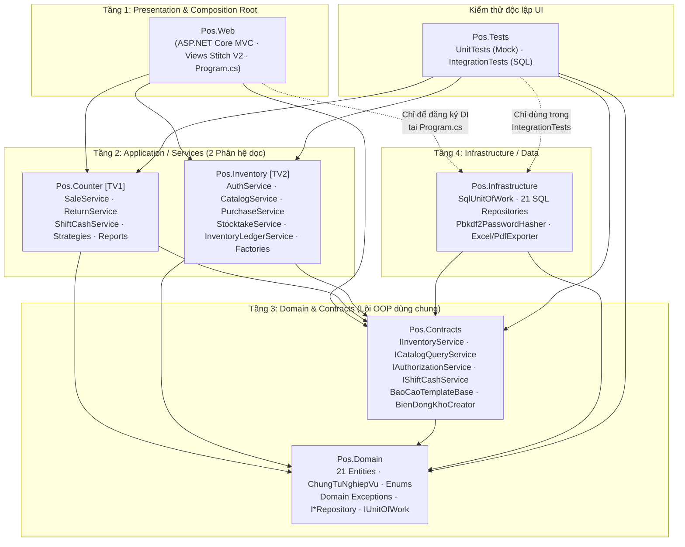
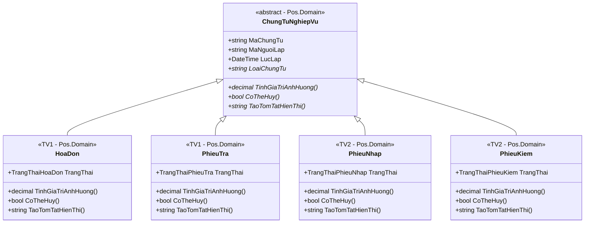
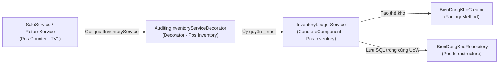

# Thiết kế Kiến trúc Tổng thể, Hợp đồng Phân hệ và OOP — Retail Core POS

**Môn học:** Bài tập lớn Lập trình hướng đối tượng / HTTTQL (`MI4090`) — Nhóm 02 sinh viên  
**Phạm vi:** 1 cửa hàng bán lẻ · 1 kho duy nhất · 1 CSDL SQL Server (21 bảng 3NF) · 8 nhóm / 31 chức năng BFD (`F1.1–F8.5`) · 3 vai trò / 40 mã quyền RBAC  
**Nền tảng công nghệ chốt:** C# `.NET 8` · `ASP.NET Core MVC` (Razor Views từ bộ giao diện Stitch V2) · `SQL Server` · `xUnit` + `Moq`  
**Tài liệu nguồn đối chiếu:**
- [Checklist_BTL_HTTTQL_2026.md](../references/Checklist_BTL_HTTTQL_2026.md) (trọng tâm: `2.4`, `4.3`, `4.4`, `4.5`, `4.6`)
- [Dac-ta-chuc-nang-POS-31.docx](../analysis/Dac-ta-chuc-nang-POS-31.docx)
- [Quy-tac-nghiep-vu-va-RBAC-POS-da-chot.docx](../analysis/Quy-tac-nghiep-vu-va-RBAC-POS-da-chot.docx)
- [Tu_dien_du_lieu_POS.md](Tu_dien_du_lieu_POS.md)

---

## 1. Cấu trúc Solution & Kiến trúc Phân tầng (Checklist `2.4`, `4.3`)

### 1.1. Kiến trúc 4 tầng kết hợp 2 phân hệ dọc (Modular Layered Architecture)

Hệ thống áp dụng **kiến trúc 4 tầng ngang** kết hợp **2 phân hệ dọc độc lập (TV1 — Quầy, TV2 — Kho & Quản trị)** giao tiếp qua lớp hợp đồng chung:

| Tầng | Project C# | Trách nhiệm chính | Quy tắc phụ thuộc |
|---|---|---|---|
| **Tầng 1 — Presentation & Composition Root** | `Pos.Web` | Controllers, ViewModels, Razor Views (kế thừa Stitch V2 trên 01 `_Layout.cshtml`), kiểm tra đầu vào phía UI, lắp ghép DI tại `Program.cs`. | Chỉ gọi `Pos.Contracts`, `Pos.Counter`, `Pos.Inventory`, `Pos.Infrastructure` (để đăng ký DI). **Không viết SQL, không chứa quy tắc `QT01–QT12`.** |
| **Tầng 2 — Application / Services** | `Pos.Counter` (TV1)<br>`Pos.Inventory` (TV2) | Điều phối ca nghiệp vụ `F1–F8`, gọi `IAuthorizationService` kiểm quyền RBAC, quản lý biên Transaction qua `IUnitOfWork`, cài đặt các hợp đồng của phân hệ mình. | Chỉ tham chiếu `Pos.Domain` và `Pos.Contracts`. **TV1 và TV2 tuyệt đối KHÔNG tham chiếu trực tiếp lẫn nhau** và **KHÔNG tham chiếu `Pos.Infrastructure` hay `Pos.Web`.** |
| **Tầng 3 — Domain & Contracts (Lõi OOP dùng chung)** | `Pos.Domain`<br>`Pos.Contracts` | `Pos.Domain`: 21 Entity giàu hành vi, Enum, Domain Exceptions, Interface Repository & `IUnitOfWork`.<br>`Pos.Contracts`: Interface biên TV1 ↔ TV2, DTO, lớp cha trừu tượng cho LSP & GoF. | **Không phụ thuộc UI, không phụ thuộc SQL Server / EF Core.** `Pos.Contracts` chỉ tham chiếu `Pos.Domain`. |
| **Tầng 4 — Infrastructure / Data** | `Pos.Infrastructure` | Cài đặt `I*Repository` truy cập 21 bảng SQL Server (truy vấn tham số hóa, khóa dòng `UPDLOCK, HOLDLOCK` theo `Tu_dien_du_lieu_POS.md`), `SqlUnitOfWork`, băm mật khẩu, đồng hồ UTC, xuất Excel/PDF. | Tham chiếu ngược vào `Pos.Domain` và `Pos.Contracts` (tuân thủ **DIP**). |

### 1.2. Cây thư mục Solution chuẩn Checklist `2.4`

```text
RetailCorePos/
├── RetailCorePos.sln
├── README.md
├── .gitignore
├── Database/                                  # [Checklist 2.4 & 1.3] Script CSDL tách riêng
│   ├── 01_Schema.sql                          # 21 bảng 3NF, SEQUENCE, PK/FK/UK/CHECK, INDEX
│   ├── 02_SeedData.sql                        # ≥ 120 bản ghi liên thông 2–3 tháng, đủ 3 vai trò
│   └── 03_ResetDatabase.ps1                   # Tái lập CSDL bằng 1 thao tác
├── Resource/                                  # [Checklist 2.4] Tài nguyên tĩnh offline
│   ├── css/                                   # Tailwind/CSS đóng gói cục bộ (không phụ thuộc CDN)
│   ├── icons/                                 # Icon cục bộ
│   ├── fonts/                                 # Plus Jakarta Sans, Inter (xuất PDF chuẩn tiếng Việt)
│   └── templates/                             # Mẫu in hóa đơn, phiếu trả, phiếu bàn giao ca
├── docs/                                      # Tài liệu khảo sát, phân tích, thiết kế
├── src/
│   ├── Pos.Domain/                            # Lõi miền OOP dùng chung (không phụ thuộc ngoài)
│   │   ├── Common/                            # ChungTuNghiepVu (abstract), EntityBase
│   │   ├── Entities/                          # 21 thực thể khớp 100% Tu_dien_du_lieu_POS.md
│   │   ├── Enums/                             # 11 enum trạng thái/phân loại
│   │   ├── Exceptions/                        # Hệ ngoại lệ dùng chung (Checklist 2.2)
│   │   └── Repositories/                      # IUnitOfWork, ITransactionScope, I*Repository
│   ├── Pos.Contracts/                         # Hợp đồng biên TV1 ↔ TV2 & lớp trừu tượng GoF
│   │   ├── Counter/                           # IShiftCashService, ICounterReportQueryService, DTOs
│   │   ├── Inventory/                         # IInventoryService, ICatalogQueryService, IAuthorizationService, DTOs
│   │   ├── Payments/                          # IPhuongThucThanhToanStrategy
│   │   ├── Ledger/                            # BienDongKhoCreator (Factory Method)
│   │   └── Reports/                           # IBaoCaoNghiepVu, BaoCaoTemplateBase<TFilter, TResult>
│   ├── Pos.Counter/                           # [MODULE TV1 — QUẦY: F3, F4, F7, F8.1–F8.2, F8.4]
│   │   ├── Services/                          # SaleService, ReturnService, ShiftCashService, CounterAuditSummaryService
│   │   ├── Strategies/                        # TienMatStrategy, ChuyenKhoanStrategy, PaymentProcessorContext
│   │   └── Reports/                           # BaoCaoBanTra, BaoCaoThanhToanLechCa, BaoCaoTongHopCuoiNgay
│   ├── Pos.Inventory/                         # [MODULE TV2 — KHO & QUẢN TRỊ: F1, F2, F5, F6, F8.3, F8.5]
│   │   ├── Services/                          # AuthService, AuthorizationService, CatalogService, PurchaseService,
│   │   │                                      # StocktakeService, InventoryLedgerService
│   │   ├── Decorators/                        # AuthorizedInventoryServiceDecorator, AuditingInventoryServiceDecorator
│   │   ├── Factories/                         # XuatBanLedgerCreator, DaoXuatBanLedgerCreator, NhapTraLedgerCreator,
│   │   │                                      # NhapKhoLedgerCreator, DaoNhapKhoLedgerCreator, DieuChinhKiemKhoLedgerCreator
│   │   └── Reports/                           # BaoCaoXuatNhapTon, BaoCaoNhapCongNo
│   ├── Pos.Infrastructure/                    # [TẦNG 4 — DATA & EXTERNAL]
│   │   ├── Persistence/                       # SqlConnectionFactory, SqlUnitOfWork, SequenceCodeGenerator
│   │   ├── Repositories/                      # Cài đặt I*Repository cho 21 bảng SQL Server
│   │   ├── Security/                          # Pbkdf2PasswordHasher
│   │   ├── Time/                              # SystemUtcClock
│   │   └── Export/                            # ExcelReportExporter, PdfReportExporter
│   └── Pos.Web/                               # [TẦNG 1 — ASP.NET CORE MVC & COMPOSITION ROOT]
│       ├── Program.cs                         # Điểm lắp ghép DI duy nhất (Composition Root)
│       ├── appsettings.json                   # Cấu hình máy cục bộ (gitignored hoặc override)
│       ├── appsettings.Example.json           # Tệp cấu hình mẫu (Checklist 2.3)
│       ├── Controllers/                       # Tách rõ nhóm TV1 (Sales, Returns, Shifts) & TV2 (Admin, Catalog, Purchases, Stocktakes)
│       ├── ViewModels/                        # Validation phía form (DataAnnotations)
│       └── Views/
│           ├── Shared/_Layout.cshtml          # 01 cửa sổ chính dùng chung cho 18 màn hình (Stitch V2)
│           ├── dm_NhomHang/                   # [Checklist 2.4] Tiền tố dm_ cho màn hình danh mục đơn
│           ├── dm_MatHang/
│           ├── dm_NhaCungCap/
│           ├── dm_TaiKhoan/
│           ├── nv_BanHang/                    # [Checklist 2.4] Tiền tố nv_ cho màn hình nghiệp vụ
│           ├── nv_TraHang/
│           ├── nv_CaBanThuChi/
│           ├── nv_NhapHang/
│           ├── nv_KiemKho/
│           └── nv_BaoCao/
└── tests/
    └── Pos.Tests/                             # Chạy độc lập không cần Pos.Web (Checklist 4.3, 5.1, 5.2)
        ├── UnitTests/
        │   ├── Counter/                       # ≥ 9 Unit Test TV1 (≥ 2 ca Mock IInventoryService, IAuthorizationService)
        │   └── Inventory/                     # ≥ 9 Unit Test TV2 (≥ 2 ca Mock IShiftCashService, IAuthorizationService)
        └── IntegrationTests/                  # ≥ 8 Integration Test (TC-IT-01..05 + báo cáo khớp tính tay)
```

> **Ghi chú quy ước Checklist `2.4`:** Với ASP.NET Core MVC, quy ước `frm_dm_` / `frm_nv_` trong `HuongdanXDHTTTQL` được ánh xạ nhất quán thành tiền tố thư mục View `dm_*` (danh mục: `NhomHang`, `MatHang`, `NhaCungCap`, `TaiKhoan`) và `nv_*` (nghiệp vụ: `BanHang`, `TraHang`, `CaBanThuChi`, `NhapHang`, `KiemKho`, `BaoCao`), kết hợp 2 thư mục chuẩn `Database/` và `Resource/` ở gốc Solution.

### 1.3. Package Diagram (≥ 3 tầng, không phụ thuộc vòng)



**Chứng minh tính hợp lệ của đồ thị phụ thuộc (Checklist `4.3`):**
1. **Đồ thị không chu trình (DAG):** Mọi mũi tên đều hướng về lõi `Pos.Domain` và `Pos.Contracts`; không có bất kỳ vòng lặp phụ thuộc nào.
2. **Tách biệt TV1 ↔ TV2:** `Pos.Counter` **không** có `<ProjectReference>` tới `Pos.Inventory` và ngược lại. Mọi tương tác liên phân hệ bắt buộc đi qua `Pos.Contracts`.
3. **Tách SQL khỏi UI và khỏi lõi nghiệp vụ:** `Pos.Web`, `Pos.Counter`, `Pos.Inventory`, `Pos.Domain` không tham chiếu `Microsoft.Data.SqlClient` hay chuỗi SQL; toàn bộ mã SQL cô lập trong `Pos.Infrastructure`.
4. **Kiểm thử không cần giao diện:** `Pos.Tests` không tham chiếu `Pos.Web`, cho phép chạy toàn bộ Unit Test và Integration Test thuần bằng `dotnet test`.

### 1.4. Ranh giới phân công TV1 ↔ TV2 và lý do thiết kế

| Tiêu chí | TV1 — Phân hệ Quầy (`Pos.Counter`) | TV2 — Phân hệ Kho & Hệ thống (`Pos.Inventory`) |
|---|---|---|
| **Nhóm chức năng BFD** | `F3` (Bán hàng), `F4` (Nhận trả), `F7` (Ca & Sổ quỹ), `F8.2` (Bán–Trả), `F8.4` (Thanh toán–Lệch ca), phối hợp `F8.1` | `F1` (Hệ thống & RBAC), `F2` (Danh mục), `F5` (Nhập hàng & Trả NCC), `F6` (Kiểm kho & Thẻ kho), `F8.3` (Xuất–Nhập–Tồn), `F8.5` (Nhập–Công nợ), phối hợp `F8.1` |
| **Bảng CSDL sở hữu trực tiếp (21 bảng)** | **8 bảng:** `CaBan`, `PhieuThuChi`, `HoaDon`, `DongBan`, `ThanhToanBan`, `PhieuTra`, `DongTra`, `KhoanHoan` | **13 bảng:** `TaiKhoan`, `VaiTro`, `QuyenVaiTro`, `Quyen`, `NhomHang`, `MatHang`, `NhaCungCap`, `PhieuNhap`, `DongNhap`, `TraNhaCungCap`, `PhieuKiem`, `DongKiem`, `BienDongKho` |
| **Quy tắc nghiệp vụ chủ trì (12 QT)** | **6 QT:** `QT01`, `QT02`, `QT03`, `QT04`, `QT05`, `QT06` | **6 QT:** `QT07`, `QT08`, `QT09`, `QT10`, `QT11`, `QT12` |

**Lý do chọn ranh giới này:**
- **Một chủ sở hữu duy nhất cho sổ thẻ kho bất biến (`BienDongKho`):** Chỉ TV2 được quyền ghi thẻ kho qua `IInventoryService` và kiểm tra tồn dưới khóa dòng (`QT02`, `QT12`). Nhờ đó tránh tình trạng cả Quầy và Kho cùng tự tính/ghi tồn gây sai lệch hoặc ghi trùng `khoaSuKien`.
- **Một chủ sở hữu duy nhất cho két tiền mặt (`CaBan`):** Chỉ TV1 quản lý trạng thái `DangMo`/`DaDong` và khóa dòng két ca (`QT05`, `QT06`). Khi Quản lý ghi khoản trả NCC lấy tiền từ két (`F5.3`, `QT09`), TV2 phải gọi sang `IShiftCashService` của TV1 để kiểm tra và khóa ca mở hợp lệ.
- **Đảm bảo cân bằng khối lượng 40–60% (Checklist `1.4`):** Mỗi người nắm 6 quy tắc nghiệp vụ, 4–5 giao dịch phức hợp/Master–Detail và 2–3 báo cáo.

---

## 2. Hợp đồng Giao tiếp TV1 ↔ TV2 & Áp dụng SOLID / DI (Checklist `4.5`)

### 2.1. Danh sách Interface biên giữa hai phân hệ (đặt tại `Pos.Contracts`)

| # | Interface | Cài đặt | Bên gọi | Chữ ký phương thức chính & DTO | Quy tắc gắn kết |
|---|---|---|---|---|---|
| 1 | **`IInventoryService`** | `Pos.Inventory` (TV2) | `Pos.Counter` (TV1) | • `Task<KetQuaGhiTheKhoDto> GhiNhanXuatBanAsync(YeuCauXuatBanDto req, CancellationToken ct)`<br>• `Task<KetQuaGhiTheKhoDto> DaoXuatBanAsync(YeuCauDaoXuatBanDto req, CancellationToken ct)`<br>• `Task<KetQuaGhiTheKhoDto> GhiNhanNhapTraHangAsync(YeuCauNhapTraDto req, CancellationToken ct)`<br>• `Task<int> LayTonHienHanhAsync(string maHang, CancellationToken ct)` | `QT02`, `QT03`, `QT04`, `QT12` |
| 2 | **`ICatalogQueryService`** | `Pos.Inventory` (TV2) | `Pos.Counter` (TV1) | • `Task<MatHangBanDto?> LayMatHangDangHoatDongAsync(string maHang, CancellationToken ct)`<br>• `Task<IReadOnlyList<MatHangBanDto>> TimKiemMatHangBanAsync(string? tuKhoa, string? maNhom, CancellationToken ct)`<br>• `Task<IReadOnlyList<NhomHangDto>> LayNhomHangHoatDongAsync(CancellationToken ct)` | `QT08` |
| 3 | **`IAuthorizationService`** | `Pos.Inventory` (TV2) | `Pos.Counter` (TV1) & `Pos.Inventory` (TV2) | • `Task KiemTraQuyenAsync(string maTaiKhoan, string maQuyen, CancellationToken ct)` *(ném `UnauthorizedActionException` nếu thiếu quyền)*<br>• `Task<IReadOnlySet<string>> LayTapQuyenAsync(string maTaiKhoan, CancellationToken ct)` | `QT07`, `QĐ01–QĐ03` |
| 4 | **`IShiftCashService`** | `Pos.Counter` (TV1) | `Pos.Inventory` (TV2) | • `Task<ThongTinCaMoDto> KiemTraVaKhoaCaMoChoChiNccAsync(string maCaChi, CancellationToken ct)`<br>• `Task<IReadOnlyList<ThongTinCaMoDto>> LayDanhSachCaDangMoAsync(CancellationToken ct)` | `QT06`, `QT09`, `QĐ01` |
| 5 | **`ICounterReportQueryService`** | `Pos.Counter` (TV1) | `Pos.Inventory` (TV2) / `BaoCaoTongHopCuoiNgay` | • `Task<TongHopBanTraCaDto> LayTongHopBanTraTrongNgayAsync(DateTime tuUtc, DateTime denUtc, CancellationToken ct)` | `F8.1`, `QT12` |
| 6 | **`IInventoryReportQueryService`** | `Pos.Inventory` (TV2) | `Pos.Counter` (TV1) / `BaoCaoTongHopCuoiNgay` & `ShiftCashService` | • `Task<decimal> TinhTongChiNccTuKetTheoCaAsync(string maCa, CancellationToken ct)`<br>• `Task<TongHopChiNccTrongKyDto> LayTongHopChiNccTheoKyAsync(DateTime tuUtc, DateTime denUtc, CancellationToken ct)` | `QT06`, `QT09`, `F7.3–F7.4`, `F8.1`, `F8.4` |

> **Chú ý chuẩn `Tu_dien_du_lieu_POS.md`:** `ShiftCashService.TinhTienDuKienAsync(maCa)` (TV1) cần trừ khoản `Chi NCC từ két (−)` (`TraNhaCungCap` thuộc TV2). Thay vì TV1 truy vấn thẳng bảng `TraNhaCungCap`, TV1 gọi `IInventoryReportQueryService.TinhTongChiNccTuKetTheoCaAsync(maCa)` — giữ sạch 100% biên dữ liệu hai phân hệ.

### 2.2. Cơ chế Dependency Injection & Transaction liên phân hệ (`IUnitOfWork`)

#### a) Composition Root duy nhất tại `Pos.Web/Program.cs`
Toàn bộ phụ thuộc đều được **tiêm qua Constructor (Constructor Injection)** và đăng ký vòng đời `Scoped` (1 phiên xử lý / 1 request) tại `Program.cs`:
- Đăng ký `IUnitOfWork` → `SqlUnitOfWork` (Scoped): giữ 1 `SqlConnection` và 1 `SqlTransaction` hiện hành cho toàn bộ các Repository thuộc cả TV1 và TV2 trong cùng một luồng xử lý.
- Đăng ký toàn bộ `I*Repository` (Scoped) dùng chung `SqlUnitOfWork` này.
- Đăng ký Services TV1 (`SaleService`, `ReturnService`, `ShiftCashService`...) và TV2 (`InventoryLedgerService`, `PurchaseService`, `StocktakeService`, `AuthorizationService`...).
- Đăng ký Decorator (mục 4.4) bọc ngoài `IInventoryService`.

#### b) Biên giao dịch liên phân hệ (ACID & Rollback — Checklist `2.2`, `QT02`, `TC-IT-04`)
Ví dụ luồng `SaleService.XacNhanBanAsync(maHoaDon, maTaiKhoan)`:
1. `SaleService` (TV1) gọi `IAuthorizationService.KiemTraQuyenAsync(maTaiKhoan, "BAN_XAC_NHAN")`.
2. `SaleService` gọi `await _unitOfWork.BeginTransactionAsync(ct)` mở **01 SQL Transaction chung**.
3. `SaleService` khóa dòng `CaBan` và `HoaDon` theo thứ tự khóa chuẩn, kiểm tra `QT01` (tổng thanh toán khớp tổng dòng bán), chuyển `HoaDon` sang `DaXacNhan`, lưu cập nhật qua `IHoaDonRepository`.
4. `SaleService` gọi `_inventoryService.GhiNhanXuatBanAsync(req, ct)` (TV2). Vì `IInventoryLedgerRepository` dùng **cùng instance `SqlUnitOfWork` đang giữ `SqlTransaction`**, TV2 khóa các dòng `MatHang` theo thứ tự mã `maHang` tăng dần (`UPDLOCK, HOLDLOCK`), đọc lại tồn kho và ghi `BienDongKho` với `khoaSuKien = "XuatBan:{maDongBan}"`.
5. Nếu một mặt hàng thiếu tồn (`TC-IT-04`), TV2 ném `InsufficientStockException` → khối `catch` của `SaleService` gọi `await _unitOfWork.RollbackAsync(CancellationToken.None)` → **hoàn tác 100% cả `HoaDon`, `ThanhToanBan` (TV1) lẫn mọi dòng `BienDongKho` đã ghi trước đó (TV2)** rồi ném lại ngoại lệ gốc. Nếu rollback cũng lỗi, lưu lỗi rollback vào `Exception.Data` của ngoại lệ gốc để giữ thông tin chẩn đoán.
6. Nếu toàn bộ hợp lệ → `await _unitOfWork.CommitAsync(ct)`.

Nếu SQL Server đã kết thúc transaction, `SqlUnitOfWork` từ chối tạo lệnh mới trên transaction đó. Nếu có cơ chế thử lại cho lỗi tạm thời như deadlock, thử lại toàn bộ nghiệp vụ trong một transaction mới.

### 2.3. Áp dụng SOLID (SRP, ISP, DIP) & Chứng minh khả năng hoán đổi

- **SRP (Single Responsibility Principle):** Tách bạch `SaleService` (bán hàng), `ReturnService` (nhận trả), `ShiftCashService` (ca & quỹ), `InventoryLedgerService` (ghi thẻ kho), `AuthorizationService` (kiểm quyền) và `Pbkdf2PasswordHasher` (băm mật khẩu). Mỗi lớp chỉ có 1 lý do để thay đổi.
- **ISP (Interface Segregation Principle):** Thay vì tạo 1 interface khổng lồ `IInventoryModuleService` chứa cả quản lý danh mục, nhập hàng, kiểm kho, thẻ kho và báo cáo, ta tách thành các interface hẹp theo nhu cầu từng bên gọi: `IInventoryService` (ghi thẻ kho), `ICatalogQueryService` (tra danh mục bán), `IAuthorizationService` (kiểm quyền), `IInventoryReportQueryService` (truy vấn đối soát chi NCC).
- **DIP (Dependency Inversion Principle):** Cả `Pos.Counter` (TV1) và `Pos.Infrastructure` (SQL) đều phụ thuộc vào trừu tượng (`Pos.Contracts` và `Pos.Domain`), không phụ thuộc lớp cụ thể.
- **Chứng minh thay cài đặt của TV2, TV1 vẫn biên dịch (Checklist `4.5`):**
  - Trong `Pos.Tests/UnitTests/Counter/SaleServiceTests.cs`, TV1 khởi tạo `new SaleService(mockHoaDonRepo, mockCaRepo, stubInventoryService, stubAuthService, fakeUnitOfWork)` với `stubInventoryService` là bản giả lập của `IInventoryService` (không tham chiếu `Pos.Inventory`).
  - Thậm chí khi tạm thời thay `InventoryLedgerService` bằng một lớp cài đặt khác (hoặc xóa project `Pos.Inventory` khỏi reference của `Pos.Counter`), `Pos.Counter` vẫn **biên dịch thành công 100%** và chạy đủ Unit Test.

---

## 3. Đóng gói (Encapsulation) & ≥ 2 Nhánh Kế thừa / Đa hình thỏa LSP (Checklist `4.4`)

### 3.1. Nguyên tắc đóng gói bảo vệ bất biến (Anti-Anemic Domain Model)

Mọi Entity trong `Pos.Domain` áp dụng chặt 4 nguyên tắc đóng gói:
1. **Không công khai `set` tự do:** Tất cả thuộc tính nghiệp vụ dùng `private set;` (hoặc `init;` cho mã định danh).
2. **Bảo vệ danh sách con:** Các tập hợp như `DongBan`, `ThanhToanBan`, `DongTra`, `KhoanHoan`, `DongNhap`, `DongKiem` được giữ trong `private readonly List<T>` và chỉ phơi bày `IReadOnlyCollection<T>` ra ngoài. Mọi thao tác thêm/sửa/xóa dòng phải đi qua phương thức của aggregate cha (`hoaDon.ThemDongBan(...)`, `phieuTra.ThemDongTra(...)`).
3. **Kiểm tra bất biến ngay tại Constructor & Phương thức:**
   - `DongBan`: chặn `soLuongBan <= 0`, `donGiaThucBan < 0`.
   - `DongTra`: chặn `soLuongTra <= 0` và chặn `soLuongNhapLai < 0 || soLuongNhapLai > soLuongTra` (`QĐ05`).
   - `ThanhToanBan`: chặn `soTienThanhToan <= 0`; nếu `TienMat` thì bắt buộc `tienKhachDua >= soTienThanhToan`, nếu `ChuyenKhoan` thì `tienKhachDua` phải `null` (`QT01`).
   - `BienDongKho`: chỉ cho phép tạo qua Factory; không có phương thức sửa/xóa (bất biến 100%, `QT12`).
4. **Chuyển trạng thái có điều kiện (State Guard):** Không ai gán được `hoaDon.TrangThai = TrangThaiHoaDon.DaHuy`. Phải gọi `hoaDon.XacNhan(lucXacNhan)` hoặc `hoaDon.Huy(maNguoiHuy, lucHuy, lyDoHuy, maCaDao)` — nếu trạng thái nguồn không hợp lệ sẽ ném ngay `InvalidStateTransitionException`.

### 3.2. Ba nhánh kế thừa / đa hình thỏa LSP (có 2 nhánh xuyên biên TV1 ↔ TV2)



#### Nhánh LSP 1 (Xuyên biên TV1 ↔ TV2): Phân cấp `ChungTuNghiepVu`
- **Lớp cha trừu tượng (`Pos.Domain`):** `ChungTuNghiepVu` định nghĩa hợp đồng chung cho mọi chứng từ có vòng đời trong cửa hàng:
  - `TinhGiaTriAnhHuong()` → trả giá trị tài chính/chênh lệch có dấu theo đúng bản chất chứng từ (`HoaDon`: `+tongBan`; `PhieuTra`: `-tongHoan`; `PhieuNhap`: `+tongNhap`; `PhieuKiem`: `0` vì chỉ điều chỉnh số lượng).
  - `CoTheHuy()` → trả `true`/`false` theo đúng vòng đời trạng thái mà không ném ngoại lệ bất ngờ (`PhieuTra` chỉ `true` khi `Nhap` để bỏ nháp theo `QĐ04`; `HoaDon`/`PhieuNhap` `true` khi `Nhap` hoặc `DaXacNhan`; `PhieuKiem` `true` khi `DangKiem` hoặc `ChoDuyet`).
  - `TaoTomTatHienThi()` → trả chuỗi mô tả chuẩn cho bảng nhật ký/báo cáo tổng hợp.
- **Lớp con TV1:** `HoaDon`, `PhieuTra`.
- **Lớp con TV2:** `PhieuNhap`, `PhieuKiem`.
- **Chứng minh thỏa LSP xuyên biên (không `is`/`as`/ép kiểu):**
  - TV1 cài đặt `CounterAuditSummaryService.TaoBangTongHopChungTu(IEnumerable<ChungTuNghiepVu> danhSach)` chỉ gọi đúng 3 phương thức ảo `ct.MaChungTu`, `ct.TinhGiaTriAnhHuong()`, `ct.TaoTomTatHienThi()`, `ct.CoTheHuy()`.
  - Khi truyền các đối tượng `PhieuNhap` và `PhieuKiem` do TV2 tạo vào hàm này của TV1, hàm chạy đúng 100%, không cần `if (ct is PhieuNhap)` hay ép kiểu, không suy yếu hậu điều kiện và không ném `NotSupportedException`.

#### Nhánh LSP 2 (Xuyên biên TV1 ↔ TV2): Phân cấp `IBaoCaoNghiepVu` / `BaoCaoTemplateBase`
- **Kiểu cha (`Pos.Contracts`):** `IBaoCaoNghiepVu` với phương thức đa hình `string MaQuyenYeuCau`, `string TenBaoCao`, `Task<KetQuaBaoCaoDto> ThucThiAsync(BoLocBaoCaoDto boLoc, string maTaiKhoan, CancellationToken ct)`.
- **Lớp con TV1:** `BaoCaoBanTra` (`F8.2`), `BaoCaoThanhToanLechCa` (`F8.4`), `BaoCaoTongHopCuoiNgay` (`F8.1`).
- **Lớp con TV2:** `BaoCaoXuatNhapTon` (`F8.3`), `BaoCaoNhapCongNo` (`F8.5`).
- **Chứng minh thỏa LSP:** Dịch vụ điều phối & xuất file (`ReportExportOrchestrator.ChayVaXuatExcelAsync(IBaoCaoNghiepVu baoCao, ...)`) nhận bất kỳ báo cáo nào của TV1 hay TV2 đều chạy cùng 1 luồng chuẩn (kiểm quyền → tính số liệu → xuất Excel/PDF) mà không kiểm tra kiểu cụ thể.

#### Nhánh LSP 3 (Nội bộ TV1): Phân cấp `IPhuongThucThanhToanStrategy`
- **Kiểu cha (`Pos.Contracts`):** `IPhuongThucThanhToanStrategy` với `KiemTraHopLe(...)`, `TinhTienThua(...)`, `TinhAnhHuongKetCa(...)`.
- **Lớp con TV1:** `TienMatStrategy`, `ChuyenKhoanStrategy`.
- **Chứng minh thỏa LSP:** `PaymentProcessorContext` duyệt qua danh sách `ThanhToanBan` / `KhoanHoan` và gọi thẳng các phương thức trên `IPhuongThucThanhToanStrategy` — `ChuyenKhoanStrategy` trả tiền thừa `0` và ảnh hưởng két `0` (hợp lệ theo hậu điều kiện `>= 0` / giá trị tài chính), không ném `NotImplementedException` và không cần `if (pt == TienMat)`.

---

## 4. Thiết kế 4 Mẫu GoF (Đủ 3 Nhóm) & Kịch bản Live OCP (Checklist `4.6`)

> Tuân thủ nghiêm ngặt Checklist `4.6`: **KHÔNG tính Repository và MVC** vào chỉ tiêu GoF. Hệ thống triển khai **4 mẫu GoF phủ đủ cả 3 nhóm** (Hành vi, Khởi tạo, Cấu trúc), mỗi thành viên chủ trì ≥ 1 mẫu và có 3 mẫu nối trực tiếp 2 phân hệ.

| # | Mẫu GoF | Nhóm mẫu | Phụ trách | Phạm vi | Bài toán trong POS |
|---|---|---|---|---|---|
| 1 | **Strategy** | Hành vi (Behavioral) | **TV1** | Nội bộ Quầy (`F3.2`, `F4.2`) | Xử lý đa phương thức thanh toán / hoàn tiền & tính ảnh hưởng két ca |
| 2 | **Template Method** | Hành vi (Behavioral) | **TV1 + TV2** | **Nối 2 phân hệ** (`F8.1–F8.5`) | Khung chuẩn hóa 5 báo cáo thống kê (RBAC → UTC → Query → Tổng hợp → Xuất) |
| 3 | **Factory Method** | Khởi tạo (Creational) | **TV2** | **Nối 2 phân hệ** (`QT12`, `F3–F6`) | Khởi tạo `BienDongKho` bất biến theo 6 loại sự kiện (đúng dấu, 1 FK nguồn, `khoaSuKien`) |
| 4 | **Decorator** | Cấu trúc (Structural) | **TV2 + TV1** | **Nối 2 phân hệ** (`QT07`, `F3–F6`) | Bọc kiểm quyền RBAC & ghi nhật ký kiểm toán quanh `IInventoryService` |

### 4.1. Mẫu 1 — Strategy (Nhóm Hành vi · TV1 phụ trách)

- **Bài toán thực tế:** Khi thu ngân ghi nhận thanh toán hỗn hợp (`F3.2`) hoặc hoàn tiền (`F4.2`), mỗi phương thức (`TienMat`, `ChuyenKhoan`) có quy tắc kiểm tra `tienKhachDua`, cách tính tiền thừa và mức ảnh hưởng vào két ca (`QT01`, `QT06`) khác nhau. Nếu dùng `switch/if` rải rác trong `SaleService`, `ReturnService`, `ShiftCashService` sẽ rất khó bảo trì và vi phạm OCP.
- **Vai trò các lớp:**
  - `IPhuongThucThanhToanStrategy` *(Strategy — `Pos.Contracts`)*: định nghĩa `PhuongThucThanhToan LoaiPhuongThuc`, `KiemTraHopLe(soTien, tienKhachDua)`, `TinhTienThua(soTien, tienKhachDua)`, `TinhBienDongKetCa(soTien, laKhoanThu)`.
  - `TienMatStrategy` *(ConcreteStrategy — `Pos.Counter`)*: yêu cầu `tienKhachDua >= soTien` khi bán, tính `tienThua = tienKhachDua - soTien`, trả `+soTien` (thu) hoặc `-soTien` (hoàn) vào két ca.
  - `ChuyenKhoanStrategy` *(ConcreteStrategy — `Pos.Counter`)*: yêu cầu `tienKhachDua == null`, trả `tienThua = 0`, trả ảnh hưởng két ca `= 0`.
  - `PaymentProcessorContext` *(Context — `Pos.Counter`)*: nhận `IEnumerable<IPhuongThucThanhToanStrategy>` qua DI, tra theo `LoaiPhuongThuc` để kiểm tra và tổng hợp toàn bộ khoản thanh toán/hoàn.
- **Đánh đổi thiết kế (Trade-off):**
  - *Ưu điểm:* Loại bỏ hoàn toàn nhánh `if/switch`, test độc lập từng phương thức rất gọn, mở rộng phương thức mới không sửa `SaleService`.
  - *Nhược điểm:* Tăng số lượng lớp nhỏ cho các quy tắc hiện tại mới có 2 phương thức; cần cơ chế đăng ký tập hợp Strategy trong DI.
- **Kịch bản Live OCP (TV1 tự làm trong 2–3 phút, tắt AI):**
  - *Đề bài:* Giảng viên yêu cầu hỗ trợ thêm phương thức thanh toán mới (VD: `TheNganHang` hoặc `ViDienTu`: không cho phép `tienKhachDua`, không tính tiền thừa, không cộng vào két tiền mặt).
  - *Thao tác:* Tạo 1 file mới `Pos.Counter/Strategies/ViDienTuStrategy.cs` cài đặt `IPhuongThucThanhToanStrategy` + đăng ký thêm 1 dòng `services.AddScoped<IPhuongThucThanhToanStrategy, ViDienTuStrategy>()` tại `Program.cs` (và thêm giá trị enum nếu mở rộng enum). **Không sửa 1 dòng nào trong `PaymentProcessorContext` hay `SaleService`.**

### 4.2. Mẫu 2 — Template Method (Nhóm Hành vi · TV1 + TV2 nối 2 phân hệ)

- **Bài toán thực tế:** Hệ thống có 5 báo cáo (`F8.1–F8.5`) do cả TV1 và TV2 phụ trách. Cả 5 báo cáo đều phải tuân thủ cùng một quy trình bất biến: (1) kiểm quyền RBAC `BC_*`, (2) kiểm tra & chuyển đổi khoảng ngày địa phương (`dd/MM/yyyy`) sang khoảng UTC (`datetime2(3)`), (3) truy vấn dữ liệu nguồn (tách chi tiết và thanh toán riêng theo `QT12`), (4) tổng hợp KPI, (5) chuẩn hóa dữ liệu bảng để xuất Excel/PDF.
- **Vai trò các lớp:**
  - `BaoCaoTemplateBase<TFilter, TResult>` *(AbstractClass — `Pos.Contracts`)*: phương thức khung `public async Task<KetQuaBaoCaoDto> ThucThiAsync(...)` cố định thứ tự 5 bước; định nghĩa các hook trừu tượng `MaQuyenYeuCau`, `TruyVanDuLieuNguonAsync(...)`, `TongHopSoLieu(...)`, `ChuyenThanhBangXuat(...)`.
  - Lớp con TV1 (`Pos.Counter`): `BaoCaoBanTra` (`F8.2`), `BaoCaoThanhToanLechCa` (`F8.4`), `BaoCaoTongHopCuoiNgay` (`F8.1` — gọi cả `ICounterReportQueryService` và `IInventoryReportQueryService`).
  - Lớp con TV2 (`Pos.Inventory`): `BaoCaoXuatNhapTon` (`F8.3`), `BaoCaoNhapCongNo` (`F8.5`).
- **Đánh đổi thiết kế (Trade-off):**
  - *Ưu điểm:* Tránh lặp lại mã kiểm quyền, xử lý múi giờ UTC và đóng gói xuất Excel/PDF ở 5 báo cáo; đảm bảo mọi báo cáo đều an toàn quyền truy cập (`QT07`).
  - *Nhược điểm:* Lớp con gắn chặt vào cấu trúc kế thừa của lớp cha; nếu một báo cáo tương lai cần đổi thứ tự bước thì kém linh hoạt hơn Strategy.
- **Kịch bản Live OCP (TV1 hoặc TV2 tự làm trong 2–3 phút, tắt AI):**
  - *Đề bài:* Thêm báo cáo mới (VD: TV2 thêm `BaoCaoCanhBaoTonThap` hoặc TV1 thêm `BaoCaoDoanhThuTheoThuNgan`).
  - *Thao tác:* Tạo 1 lớp mới kế thừa `BaoCaoTemplateBase<BoLocKyDto, ...>`, override `MaQuyenYeuCau`, `TruyVanDuLieuNguonAsync`, `TongHopSoLieu`, `ChuyenThanhBangXuat` + đăng ký 1 dòng vào DI. Toàn bộ luồng kiểm quyền, chuẩn hóa ngày UTC và xuất Excel/PDF tự chạy mà **không sửa `BaoCaoTemplateBase` hay `ReportExportOrchestrator`**.

### 4.3. Mẫu 3 — Factory Method (Nhóm Khởi tạo · TV2 phụ trách, nối 2 phân hệ)

- **Bài toán thực tế:** Theo `QT12` và `Tu_dien_du_lieu_POS.md`, bảng `BienDongKho` có ràng buộc cực chặt: 6 loại sự kiện (`XuatBan`, `DaoXuatBan`, `NhapTraHang`, `NhapKho`, `DaoNhapKho`, `DieuChinhKiemKho`), mỗi dòng chỉ được có **đúng 1 trong 4 cột FK nguồn khác NULL** (`maDongBan`, `maDongTra`, `maDongNhap`, `maPhieuKiem`), dấu `soLuongThayDoi` phải khớp loại sự kiện, và `khoaSuKien` phải sinh đúng chuẩn chống ghi trùng. Nếu để nhiều nơi tự `new BienDongKho(...)` sẽ rất dễ sai dấu hoặc sai khóa nguồn.
- **Vai trò các lớp:**
  - `BienDongKhoCreator` *(Creator — `Pos.Contracts`)*: định nghĩa phương thức khung `TaoBienDong(ThongTinNguonKhoDto nguon, DateTime lucGhiUtc)` thực hiện kiểm tra chung (`soLuong != 0`, `lucGhiUtc.Kind == Utc`), gọi Factory Method trừu tượng `protected abstract BienDongKho KhoiTaoTheoLoaiSuKien(...)`.
  - ConcreteCreators (`Pos.Inventory`):
    - Phục vụ yêu cầu từ TV1: `XuatBanLedgerCreator` (`-soLuong`, `maDongBan`, `"XuatBan:{maDongBan}"`), `DaoXuatBanLedgerCreator` (`+soLuong`, `maDongBan`), `NhapTraLedgerCreator` (`+soLuongNhapLai`, `maDongTra`).
    - Phục vụ nghiệp vụ TV2: `NhapKhoLedgerCreator` (`+soLuongNhap`, `maDongNhap`), `DaoNhapKhoLedgerCreator` (`-soLuongNhap`, `maDongNhap`), `DieuChinhKiemKhoLedgerCreator` (`thucDem - tonSo`, `maPhieuKiem`, `"DieuChinhKiemKho:{maPhieuKiem}:{maHang}"`).
- **Đánh đổi thiết kế (Trade-off):**
  - *Ưu điểm:* Đảm bảo 100% bất biến thẻ kho ngay lúc khởi tạo, tách rời `InventoryLedgerService` khỏi chi tiết tạo từng loại biến động.
  - *Nhược điểm:* Phát sinh 6 lớp creator nhỏ cho 6 sự kiện kho.
- **Kịch bản Live OCP (TV2 tự làm trong 2–3 phút, tắt AI):**
  - *Đề bài:* Bổ sung loại sự kiện biến động kho mới (VD: `XuatHuyHangHongLedgerCreator` sinh biến động âm kèm `khoaSuKien` chuẩn).
  - *Thao tác:* Tạo 1 lớp mới kế thừa `BienDongKhoCreator`, override `KhoiTaoTheoLoaiSuKien(...)` + đăng ký DI. **Không sửa bất kỳ creator cũ nào hay mã kiểm tra chung của `BienDongKhoCreator`.**

### 4.4. Mẫu 4 — Decorator (Nhóm Cấu trúc · TV2 + TV1 nối 2 phân hệ)

- **Bài toán thực tế:** Khi `SaleService` / `ReturnService` (TV1) hoặc `PurchaseService` / `StocktakeService` (TV2) gọi vào `IInventoryService`, ta muốn bổ sung các mối quan tâm cắt ngang (cross-cutting concerns) như **kiểm tra tính toàn vẹn người gọi/quyền thao tác** và **ghi log kiểm toán biến động kho** mà không làm phình to hay trộn lẫn logic hạ tầng vào `InventoryLedgerService`.
- **Vai trò các lớp:**
  - `IInventoryService` *(Component — `Pos.Contracts`)*.
  - `InventoryLedgerService` *(ConcreteComponent — `Pos.Inventory`)*: chỉ tập trung 100% logic khóa dòng, kiểm tra tồn, kiểm idempotency `khoaSuKien` và lưu thẻ kho.
  - `InventoryServiceDecoratorBase` *(Base Decorator — `Pos.Inventory`)*: giữ tham chiếu `protected readonly IInventoryService _inner`.
  - `AuditingInventoryServiceDecorator` *(ConcreteDecorator — `Pos.Inventory`)*: ghi vết thời điểm gọi, `maTaiKhoan`, loại sự kiện và kết quả thành công/thất bại (không nuốt ngoại lệ) trước/sau khi ủy quyền cho `_inner`.
- **Đánh đổi thiết kế (Trade-off):**
  - *Ưu điểm:* Giữ `InventoryLedgerService` ngắn gọn theo SRP; dễ bật/tắt hoặc xếp chồng thêm Decorator (VD: đo hiệu năng, kiểm quyền) tại `Program.cs` mà không sửa code nghiệp vụ.
  - *Nhược điểm:* Cấu hình DI phức tạp hơn 1 chút và tăng độ sâu Call Stack thêm 1 lớp khi debug (tuy nhiên lại hỗ trợ rất tốt cho yêu cầu đọc Call Stack qua 2 phân hệ ở Checklist `4.2`).



---

## 5. Bảng Đối chiếu Hoàn thành Checklist MI4090

| Tiêu chí Checklist | Yêu cầu cốt lõi | Đáp ứng trong tài liệu này | Minh chứng / Vị trí |
|---|---|---|---|
| **`2.4` — Chất lượng mã nguồn** | Cấu trúc Solution chuẩn `HuongdanXDHTTTQL` (`Database`, `Resource`, `dm_`, `nv_`), thống nhất tên lớp giữa 2 người | Đã chốt cấu trúc Solution `RetailCorePos.sln` có `Database/`, `Resource/`, Views `dm_*`/`nv_*` và tên thực thể/enum khớp 100% `Tu_dien_du_lieu_POS.md` | Mục `1.2` |
| **`4.3` — Kiến trúc phân tầng** | Package Diagram ≥ 3 tầng, 2 module, Domain dùng chung; tách SQL khỏi UI & lõi; không phụ thuộc vòng; chạy test không cần UI | Đã thiết kế 4 tầng + 2 module (`Pos.Counter`, `Pos.Inventory`) + `Pos.Domain`/`Pos.Contracts`, sơ đồ DAG không vòng lặp, `Pos.Tests` độc lập `Pos.Web` | Mục `1.1`, `1.3`, `1.4` |
| **`4.4` — Đóng gói & Đa hình (LSP)** | Bảo vệ invariant tại constructor/phương thức; ≥ 2 nhánh đa hình thỏa LSP; lớp con TV2 chạy đúng trong hàm nhận kiểu cha của TV1 không dùng `is`/`as` | Đã chốt 4 quy ước đóng gói + 3 nhánh LSP (2 nhánh xuyên biên: `ChungTuNghiepVu` và `IBaoCaoNghiepVu`; 1 nhánh Quầy: `IPhuongThucThanhToanStrategy`) | Mục `3.1`, `3.2` |
| **`4.5` — SOLID & Hợp đồng 2 phân hệ** | SRP, ISP, DIP/DI; giao tiếp qua interface, constructor injection, lắp ghép tại điểm khởi tạo chung; thay cài đặt TV2 thì TV1 vẫn biên dịch | Đã thiết kế 6 interface biên trong `Pos.Contracts`, mô tả DI tại `Program.cs`, `SqlUnitOfWork` cho Transaction liên phân hệ và chứng minh hoán đổi Mock/Stub | Mục `2.1`, `2.2`, `2.3` |
| **`4.6` — Mẫu GoF & Live OCP** | ≥ 3 mẫu GoF thuộc ≥ 2 nhóm (khuyến khích 3 nhóm), không tính Repository & MVC; mỗi người ≥ 1 mẫu; ≥ 1 mẫu nối 2 phân hệ; kịch bản mở rộng 2–3 phút | Đã thiết kế **4 mẫu thuộc đủ 3 nhóm**: Strategy (TV1), Template Method (TV1+TV2), Factory Method (TV2 nối TV1), Decorator (TV2+TV1), đủ trade-off & kịch bản Live OCP | Mục `4.1`–`4.4` |

---

### Bước tiếp theo (Phase 4 — Thiết kế chi tiết)
Sau khi 2 thành viên duyệt xong tài liệu kiến trúc này, nhóm chuyển ngay sang 3 sản phẩm chi tiết khớp 100% với tên lớp và chữ ký đã chốt ở trên:
1. **Sơ đồ lớp tổng (UML Class Diagram — Checklist `4.1`):** ≥ 20 lớp thực chất thể hiện đủ 6 loại quan hệ UML.
2. **≥ 4 Sơ đồ hành vi (Sequence & State Diagram — Checklist `4.2`):** gồm luồng bán hàng xuyên Quầy–Kho (`F3.3`), trả hàng (`F4.2`), vòng đời `HoaDon`/`CaBan` (TV1) và `PhieuKiem`/`PhieuNhap` (TV2).
3. **Script SQL (`Database/01_Schema.sql`, `02_SeedData.sql` ≥ 120 bản ghi) + Bảng tính tay 5 báo cáo (`F8.1–F8.5`)** và **Ma trận ≥ 26 ca kiểm thử (`5.1–5.2`)**.
