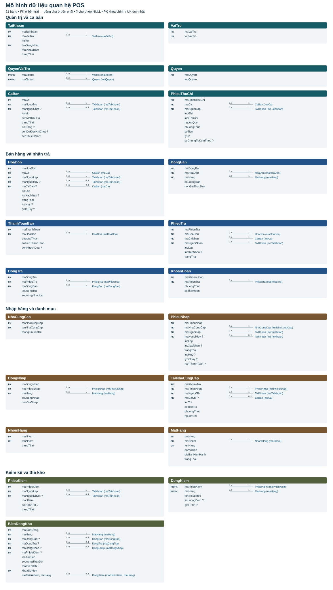
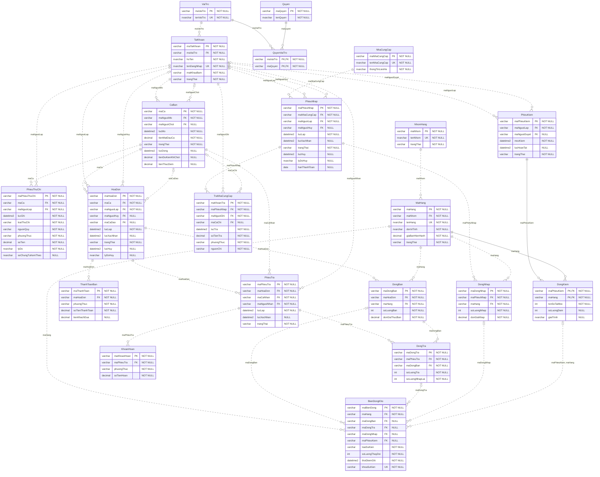

# Từ điển dữ liệu POS bán lẻ

**Phạm vi** · Một cửa hàng, một CSDL SQL Server dùng chung cho phân hệ Quầy và Kho. Tài liệu chuyển bốn cụm thực thể của ERD thành các quan hệ vật lý. Khóa và thuộc tính lấy từ [báo cáo ERD](../analysis/Bao-cao-ERD-POS.docx). Điều kiện hiệu lực lấy từ [đặc tả chức năng](../analysis/Dac-ta-chuc-nang-POS-31.docx) và [bảng quy tắc và RBAC](../analysis/Quy-tac-nghiep-vu-va-RBAC-POS-da-chot.docx).

## Quy ước vật lý đề xuất

| Dữ liệu | SQL Server | C# | Ví dụ và cơ sở lựa chọn |
|---|---|---|---|
| Mã bản ghi, mã nghiệp vụ, FK | varchar(32) | string | HD-001, TK_TN01. Giữ mã đọc được trên chứng từ. Sinh mã mới theo tiền tố bảng và SEQUENCE riêng, chấp nhận khoảng trống. Cấm tái sử dụng hoặc sửa mã đã phát hành. |
| Mã quyền, khóa ghép | varchar(64) cho maQuyen | string hoặc cặp thuộc tính | BAN_TRA_IN_HD do cấu hình cấp. Khóa ghép dùng trực tiếp các cột thành phần, giữ cùng kiểu, độ dài và collation với bên cha. |
| Tiền và đơn giá | decimal(19,0) | decimal | 25.000 đồng lưu là 25000. Nhận số nguyên VND, từ chối phần lẻ trước khi bind tham số. Giá và số thực đếm ≥ 0, khoản thu/trả > 0. Tiền dự kiến tính theo sổ và chênh lệch có dấu. Kiểm tra tràn khi nhân và tổng hợp trước khi ghi. |
| Lượng hàng | int | int, int? | Đếm theo đơn vị nguyên như hộp, lon. Lượng giao dịch > 0, nhập lại có thể bằng 0. Dòng kiểm NULL là chưa đếm, 0 là đã đếm và không có hàng. |
| Thời điểm sự kiện | datetime2(3) | DateTime (UTC) | Lưu UTC đến mili giây. Service lấy một mốc UTC cho cả lần xác nhận; khi đọc gắn lại DateTimeKind.Utc. Hiển thị giờ Việt Nam, dd/MM/yyyy HH:mm. Bộ lọc ngày chuyển hai đầu khoảng ngày địa phương sang UTC. |
| Ngày đến hạn | date | DateOnly? | 30/11/2026 là ngày nghiệp vụ của cửa hàng, hiển thị dd/MM/yyyy, không đổi múi giờ. |
| Trạng thái và phân loại | varchar(24) | enum theo từng đối tượng | Lưu tên ổn định như DaXacNhan; cấu hình chuyển enum sang chuỗi, CHECK miền riêng từng bảng. |
| Văn bản tiếng Việt | nvarchar(n) | string hoặc string? | Tên hàng 150 ký tự, giải trình 500. Mã kỹ thuật ASCII dùng varchar; mã và enum dùng cùng collation nhị phân BIN2, tên đăng nhập chuẩn hóa khoảng trắng và dùng collation CI_AS để so sánh duy nhất không phân biệt hoa thường. |
| Cờ logic | bit | bool | Nếu cần cờ hai giá trị thì dùng 0/1. ERD hiện hành biểu diễn hiệu lực bằng trạng thái, chưa cần cột cờ độc lập. |

Các cột bắt buộc do ứng dụng truyền nếu không ghi DEFAULT. Cột tùy chọn dùng NULL khi sự kiện chưa xảy ra hoặc giá trị không áp dụng. Với C#, kiểu giá trị tương ứng thêm dấu ? khi cột nullable. Một khóa nghiệp vụ ngắn được dùng trực tiếp làm PK; mã quyền và mã vai trò do bộ cấu hình cố định cấp. Các đề xuất vật lý áp dụng cho schema dbo.

## Mô hình quan hệ

Trong hình, mỗi đường nối ghi cột đích của bảng cha; tra bảng đích theo tên và khóa ghi ở đầu nối. Một cha có thể có 0..n dòng con. Phía cha ghi 1 cho FK bắt buộc, 0..1 cho FK tùy chọn. Ràng buộc phải có dòng chi tiết khi xác nhận được kiểm tại giao dịch. Mã Mermaid đầy đủ ở cuối tài liệu.

## Lược đồ và từ điển theo cụm

**Chính sách xóa áp dụng cho từng FK bên dưới:** ON DELETE NO ACTION. Xóa phiếu trả nháp là thao tác Service riêng xóa con trước cha trong cùng transaction. Danh mục ngừng dùng và tài khoản bị khóa giữ nguyên mã để chứng từ lịch sử tiếp tục tra được. Đơn giá in lại lấy từ dòng bán, không tra giá niêm yết hiện tại.

### Quản trị và ca bán

#### TaiKhoan

Hồ sơ nhân viên sử dụng POS. Tên đăng nhập duy nhất; khóa tài khoản vẫn giữ lịch sử. F1.1–F1.3

`TaiKhoan(maTaiKhoan, maVaiTro, hoTen, tenDangNhap, matKhauBam, trangThai)`

**PK** (maTaiKhoan) · **UNIQUE** tenDangNhap

**FK** (maVaiTro) → VaiTro(maVaiTro)

| Tên cột | Ý nghĩa nghiệp vụ | Kiểu SQL Server | NULL? | Mặc định/cách sinh | PK/FK/UQ/CHECK | Tham chiếu hoặc miền giá trị |
|---|---|---|---|---|---|---|
| maTaiKhoan | Định danh bản ghi TaiKhoan | varchar(32) | Không | SEQUENCE + tiền tố | PK | — |
| maVaiTro | Mã VaiTro tham chiếu | varchar(32) | Không | Từ bản ghi cha | FK | VaiTro (maVaiTro) |
| hoTen | Họ tên nhân viên | nvarchar(150) | Không | Ứng dụng truyền | — | — |
| tenDangNhap | Tên xác thực duy nhất | nvarchar(64) | Không | Ứng dụng truyền | UK, CHECK | Có nội dung khi có giá trị |
| matKhauBam | Chuỗi băm mật khẩu kèm tham số và salt | varchar(256) | Không | Ứng dụng truyền | — | — |
| trangThai | Trạng thái hiện hành | varchar(24) | Không | HoatDong | CHECK | HoatDong, BiKhoa |

#### VaiTro

Tập vai trò của cửa hàng. Tên duy nhất. F1.3

`VaiTro(maVaiTro, tenVaiTro)`

**PK** (maVaiTro) · **UNIQUE** tenVaiTro

**FK** —

| Tên cột | Ý nghĩa nghiệp vụ | Kiểu SQL Server | NULL? | Mặc định/cách sinh | PK/FK/UQ/CHECK | Tham chiếu hoặc miền giá trị |
|---|---|---|---|---|---|---|
| maVaiTro | Định danh bản ghi VaiTro | varchar(32) | Không | Cấu hình | PK | — |
| tenVaiTro | Tên vai trò hiển thị | nvarchar(150) | Không | Ứng dụng truyền | UK, CHECK | Có nội dung khi có giá trị |

#### QuyenVaiTro

Cấp quyền theo vai trò. F1.3

`QuyenVaiTro(maVaiTro, maQuyen)`

**PK** (maVaiTro, maQuyen) · **UNIQUE** —

**FK** (maVaiTro) → VaiTro(maVaiTro) · (maQuyen) → Quyen(maQuyen)

| Tên cột | Ý nghĩa nghiệp vụ | Kiểu SQL Server | NULL? | Mặc định/cách sinh | PK/FK/UQ/CHECK | Tham chiếu hoặc miền giá trị |
|---|---|---|---|---|---|---|
| maVaiTro | Mã VaiTro tham chiếu | varchar(32) | Không | Từ bản ghi cha | PK, FK | VaiTro (maVaiTro) |
| maQuyen | Mã Quyen tham chiếu | varchar(64) | Không | Từ bản ghi cha | PK, FK | Quyen (maQuyen) |

#### Quyen

Một thao tác được kiểm quyền. F1.3

`Quyen(maQuyen, tenQuyen)`

**PK** (maQuyen) · **UNIQUE** —

**FK** —

| Tên cột | Ý nghĩa nghiệp vụ | Kiểu SQL Server | NULL? | Mặc định/cách sinh | PK/FK/UQ/CHECK | Tham chiếu hoặc miền giá trị |
|---|---|---|---|---|---|---|
| maQuyen | Định danh bản ghi Quyen | varchar(64) | Không | Cấu hình | PK | — |
| tenQuyen | Tên thao tác được cấp | nvarchar(150) | Không | Ứng dụng truyền | — | — |

#### CaBan

Ca làm việc và số tiền mở két. F7.1, F3–F4, F7.3–F7.5

`CaBan(maCa, maNguoiMo, maNguoiChot, lucMo, tienMatDauCa, trangThai, lucDong, tienDuKienKhiChot, tienThucDem)`

**PK** (maCa) · **UNIQUE** — · duy nhất có điều kiện trên maNguoiMo (QT05)

**FK** (maNguoiMo) → TaiKhoan(maTaiKhoan) · (maNguoiChot) → TaiKhoan(maTaiKhoan)

| Tên cột | Ý nghĩa nghiệp vụ | Kiểu SQL Server | NULL? | Mặc định/cách sinh | PK/FK/UQ/CHECK | Tham chiếu hoặc miền giá trị |
|---|---|---|---|---|---|---|
| maCa | Định danh bản ghi CaBan | varchar(32) | Không | SEQUENCE + tiền tố | PK | — |
| maNguoiMo | Tài khoản mở ca | varchar(32) | Không | Từ bản ghi cha | FK | TaiKhoan (maTaiKhoan) |
| maNguoiChot | Tài khoản chốt ca | varchar(32) | Có | NULL | FK | TaiKhoan (maTaiKhoan) |
| lucMo | Thời điểm mở két | datetime2(3) | Không | Service (UTC) | — | — |
| tienMatDauCa | Tiền mặt kiểm đầu ca | decimal(19,0) | Không | Ứng dụng truyền | CHECK | ≥ 0 |
| trangThai | Trạng thái hiện hành | varchar(24) | Không | DangMo | CHECK | DangMo, DaDong |
| lucDong | Thời điểm chốt ca | datetime2(3) | Có | NULL | — | — |
| tienDuKienKhiChot | Số dư sổ đã chốt | decimal(19,0) | Có | NULL | CHECK | Có dấu theo đối soát |
| tienThucDem | Tiền mặt đếm khi đóng ca | decimal(19,0) | Có | NULL | CHECK | ≥ 0 |

#### PhieuThuChi

Khoản thu chi riêng như chi mua vật tư. Số chứng từ kèm theo dùng để tra biên nhận. F7.2–F7.3, F8.1, F8.4

`PhieuThuChi(maPhieuThuChi, maCa, maNguoiLap, lucGhi, loaiThuChi, nguonQuy, phuongThuc, soTien, lyDo, soChungTuKemTheo)`

**PK** (maPhieuThuChi) · **UNIQUE** —

**FK** (maCa) → CaBan(maCa) · (maNguoiLap) → TaiKhoan(maTaiKhoan)

| Tên cột | Ý nghĩa nghiệp vụ | Kiểu SQL Server | NULL? | Mặc định/cách sinh | PK/FK/UQ/CHECK | Tham chiếu hoặc miền giá trị |
|---|---|---|---|---|---|---|
| maPhieuThuChi | Định danh bản ghi PhieuThuChi | varchar(32) | Không | SEQUENCE + tiền tố | PK | — |
| maCa | Mã CaBan tham chiếu | varchar(32) | Không | Từ bản ghi cha | FK | CaBan (maCa) |
| maNguoiLap | Tài khoản lập chứng từ | varchar(32) | Không | Từ bản ghi cha | FK | TaiKhoan (maTaiKhoan) |
| lucGhi | Thời điểm ghi khoản thu hoặc chi | datetime2(3) | Không | Service (UTC) | — | — |
| loaiThuChi | Chiều của khoản thu chi riêng | varchar(24) | Không | Ứng dụng truyền | CHECK | Thu, Chi |
| nguonQuy | Quỹ chịu tác động | varchar(24) | Không | Ứng dụng truyền | CHECK | KetCa, QuyCuaHang |
| phuongThuc | Phương thức dịch chuyển tiền | varchar(24) | Không | Ứng dụng truyền | CHECK | TienMat, ChuyenKhoan |
| soTien | Giá trị khoản thu hoặc chi | decimal(19,0) | Không | Ứng dụng truyền | CHECK | > 0 |
| lyDo | Nội dung thu hoặc chi | nvarchar(500) | Không | Ứng dụng truyền | CHECK | Có nội dung khi có giá trị |
| soChungTuKemTheo | Số biên nhận hoặc chứng từ kèm theo | nvarchar(64) | Có | NULL | — | — |

### Bán hàng và nhận trả

#### HoaDon

Chứng từ bán trong ca. F3, F8.1–F8.2

`HoaDon(maHoaDon, maCa, maNguoiLap, maNguoiHuy, maCaDao, lucLap, lucXacNhan, trangThai, lucHuy, lyDoHuy)`

**PK** (maHoaDon) · **UNIQUE** —

**FK** (maCa) → CaBan(maCa) · (maNguoiLap) → TaiKhoan(maTaiKhoan) · (maNguoiHuy) → TaiKhoan(maTaiKhoan) · (maCaDao) → CaBan(maCa)

| Tên cột | Ý nghĩa nghiệp vụ | Kiểu SQL Server | NULL? | Mặc định/cách sinh | PK/FK/UQ/CHECK | Tham chiếu hoặc miền giá trị |
|---|---|---|---|---|---|---|
| maHoaDon | Định danh bản ghi HoaDon | varchar(32) | Không | SEQUENCE + tiền tố | PK | — |
| maCa | Mã CaBan tham chiếu | varchar(32) | Không | Từ bản ghi cha | FK | CaBan (maCa) |
| maNguoiLap | Tài khoản lập chứng từ | varchar(32) | Không | Từ bản ghi cha | FK | TaiKhoan (maTaiKhoan) |
| maNguoiHuy | Tài khoản hủy chứng từ | varchar(32) | Có | NULL | FK | TaiKhoan (maTaiKhoan) |
| maCaDao | Ca thực hiện đảo tiền mặt | varchar(32) | Có | NULL | FK | CaBan (maCa) |
| lucLap | Thời điểm lập chứng từ | datetime2(3) | Không | Service (UTC) | — | — |
| lucXacNhan | Thời điểm chứng từ có hiệu lực | datetime2(3) | Có | NULL | — | — |
| trangThai | Trạng thái hiện hành | varchar(24) | Không | Nhap | CHECK | Nhap, DaXacNhan, DaHuy |
| lucHuy | Thời điểm hủy chứng từ | datetime2(3) | Có | NULL | — | — |
| lyDoHuy | Lý do hủy đã ghi nhận | nvarchar(500) | Có | NULL | CHECK | Có nội dung khi có giá trị |

#### DongBan

Lưu giá thực bán để in hóa đơn và tính giá trị trả. F3, F4.1, F6.1

`DongBan(maDongBan, maHoaDon, maHang, soLuongBan, donGiaThucBan)`

**PK** (maDongBan) · **UNIQUE** —

**FK** (maHoaDon) → HoaDon(maHoaDon) · (maHang) → MatHang(maHang)

| Tên cột | Ý nghĩa nghiệp vụ | Kiểu SQL Server | NULL? | Mặc định/cách sinh | PK/FK/UQ/CHECK | Tham chiếu hoặc miền giá trị |
|---|---|---|---|---|---|---|
| maDongBan | Định danh bản ghi DongBan | varchar(32) | Không | SEQUENCE + tiền tố | PK | — |
| maHoaDon | Mã HoaDon tham chiếu | varchar(32) | Không | Từ bản ghi cha | FK | HoaDon (maHoaDon) |
| maHang | Mã MatHang tham chiếu | varchar(32) | Không | Từ bản ghi cha | FK | MatHang (maHang) |
| soLuongBan | Số đơn vị đã bán trên dòng | int | Không | Ứng dụng truyền | CHECK | > 0 |
| donGiaThucBan | Giá bán một đơn vị tại lúc bán | decimal(19,0) | Không | Ứng dụng truyền | CHECK | ≥ 0 |

#### ThanhToanBan

Mỗi lần phân bổ tiền vào một phương thức. F3.2–F3.4, F7.3, F8.4

`ThanhToanBan(maThanhToan, maHoaDon, phuongThuc, soTienThanhToan, tienKhachDua)`

**PK** (maThanhToan) · **UNIQUE** —

**FK** (maHoaDon) → HoaDon(maHoaDon)

| Tên cột | Ý nghĩa nghiệp vụ | Kiểu SQL Server | NULL? | Mặc định/cách sinh | PK/FK/UQ/CHECK | Tham chiếu hoặc miền giá trị |
|---|---|---|---|---|---|---|
| maThanhToan | Định danh bản ghi ThanhToanBan | varchar(32) | Không | SEQUENCE + tiền tố | PK | — |
| maHoaDon | Mã HoaDon tham chiếu | varchar(32) | Không | Từ bản ghi cha | FK | HoaDon (maHoaDon) |
| phuongThuc | Phương thức dịch chuyển tiền | varchar(24) | Không | Ứng dụng truyền | CHECK | TienMat, ChuyenKhoan |
| soTienThanhToan | Số tiền phân bổ thực thu theo phương thức | decimal(19,0) | Không | Ứng dụng truyền | CHECK | > 0 |
| tienKhachDua | Tiền mặt khách đưa trước khi thối | decimal(19,0) | Có | NULL | CHECK | Tiền mặt ≥ soTienThanhToan nếu có |

#### PhieuTra

Một lần nhận trả theo hóa đơn gốc. F4, F8.1–F8.2

`PhieuTra(maPhieuTra, maHoaDon, maCaNhan, maNguoiNhan, lucLap, lucXacNhan, trangThai)`

**PK** (maPhieuTra) · **UNIQUE** —

**FK** (maHoaDon) → HoaDon(maHoaDon) · (maCaNhan) → CaBan(maCa) · (maNguoiNhan) → TaiKhoan(maTaiKhoan)

| Tên cột | Ý nghĩa nghiệp vụ | Kiểu SQL Server | NULL? | Mặc định/cách sinh | PK/FK/UQ/CHECK | Tham chiếu hoặc miền giá trị |
|---|---|---|---|---|---|---|
| maPhieuTra | Định danh bản ghi PhieuTra | varchar(32) | Không | SEQUENCE + tiền tố | PK | — |
| maHoaDon | Mã HoaDon tham chiếu | varchar(32) | Không | Từ bản ghi cha | FK | HoaDon (maHoaDon) |
| maCaNhan | Ca nhận hàng trả | varchar(32) | Không | Từ bản ghi cha | FK | CaBan (maCa) |
| maNguoiNhan | Thu ngân tiếp nhận trả hàng | varchar(32) | Không | Từ bản ghi cha | FK | TaiKhoan (maTaiKhoan) |
| lucLap | Thời điểm lập chứng từ | datetime2(3) | Không | Service (UTC) | — | — |
| lucXacNhan | Thời điểm chứng từ có hiệu lực | datetime2(3) | Có | NULL | — | — |
| trangThai | Trạng thái hiện hành | varchar(24) | Không | Nhap | CHECK | Nhap, DaXacNhan |

#### DongTra

Lượng trả và lượng đủ điều kiện nhập lại. F4, F6.1, F8.2–F8.3

`DongTra(maDongTra, maPhieuTra, maDongBan, soLuongTra, soLuongNhapLai)`

**PK** (maDongTra) · **UNIQUE** —

**FK** (maPhieuTra) → PhieuTra(maPhieuTra) · (maDongBan) → DongBan(maDongBan)

| Tên cột | Ý nghĩa nghiệp vụ | Kiểu SQL Server | NULL? | Mặc định/cách sinh | PK/FK/UQ/CHECK | Tham chiếu hoặc miền giá trị |
|---|---|---|---|---|---|---|
| maDongTra | Định danh bản ghi DongTra | varchar(32) | Không | SEQUENCE + tiền tố | PK | — |
| maPhieuTra | Mã PhieuTra tham chiếu | varchar(32) | Không | Từ bản ghi cha | FK | PhieuTra (maPhieuTra) |
| maDongBan | Mã DongBan tham chiếu | varchar(32) | Không | Từ bản ghi cha | FK | DongBan (maDongBan) |
| soLuongTra | Số đơn vị khách trả | int | Không | Ứng dụng truyền | CHECK | > 0 |
| soLuongNhapLai | Phần hàng trả đủ điều kiện bán lại | int | Không | Ứng dụng truyền | CHECK | 0 … soLuongTra |

#### KhoanHoan

Một khoản hoàn theo phương thức. F4.2–F4.3, F7.3, F8.4

`KhoanHoan(maKhoanHoan, maPhieuTra, phuongThuc, soTienHoan)`

**PK** (maKhoanHoan) · **UNIQUE** —

**FK** (maPhieuTra) → PhieuTra(maPhieuTra)

| Tên cột | Ý nghĩa nghiệp vụ | Kiểu SQL Server | NULL? | Mặc định/cách sinh | PK/FK/UQ/CHECK | Tham chiếu hoặc miền giá trị |
|---|---|---|---|---|---|---|
| maKhoanHoan | Định danh bản ghi KhoanHoan | varchar(32) | Không | SEQUENCE + tiền tố | PK | — |
| maPhieuTra | Mã PhieuTra tham chiếu | varchar(32) | Không | Từ bản ghi cha | FK | PhieuTra (maPhieuTra) |
| phuongThuc | Phương thức dịch chuyển tiền | varchar(24) | Không | Ứng dụng truyền | CHECK | TienMat, ChuyenKhoan |
| soTienHoan | Giá trị hoàn theo phương thức | decimal(19,0) | Không | Ứng dụng truyền | CHECK | > 0 |

### Nhập hàng và danh mục

#### NhaCungCap

Đơn vị giao hàng, đối tượng đối chiếu nợ. F2.3, F5, F8.5

`NhaCungCap(maNhaCungCap, tenNhaCungCap, thongTinLienHe)`

**PK** (maNhaCungCap) · **UNIQUE** tenNhaCungCap

**FK** —

| Tên cột | Ý nghĩa nghiệp vụ | Kiểu SQL Server | NULL? | Mặc định/cách sinh | PK/FK/UQ/CHECK | Tham chiếu hoặc miền giá trị |
|---|---|---|---|---|---|---|
| maNhaCungCap | Định danh bản ghi NhaCungCap | varchar(32) | Không | SEQUENCE + tiền tố | PK | — |
| tenNhaCungCap | Tên nhà cung cấp | nvarchar(150) | Không | Ứng dụng truyền | UK, CHECK | Có nội dung khi có giá trị |
| thongTinLienHe | Thông tin liên hệ của nhà cung cấp | nvarchar(500) | Không | Ứng dụng truyền | — | — |

#### PhieuNhap

Đầu phiếu nhận hàng. F5, F8.5

`PhieuNhap(maPhieuNhap, maNhaCungCap, maNguoiLap, maNguoiHuy, lucLap, lucXacNhan, trangThai, lucHuy, lyDoHuy, hanThanhToan)`

**PK** (maPhieuNhap) · **UNIQUE** —

**FK** (maNhaCungCap) → NhaCungCap(maNhaCungCap) · (maNguoiLap) → TaiKhoan(maTaiKhoan) · (maNguoiHuy) → TaiKhoan(maTaiKhoan)

| Tên cột | Ý nghĩa nghiệp vụ | Kiểu SQL Server | NULL? | Mặc định/cách sinh | PK/FK/UQ/CHECK | Tham chiếu hoặc miền giá trị |
|---|---|---|---|---|---|---|
| maPhieuNhap | Định danh bản ghi PhieuNhap | varchar(32) | Không | SEQUENCE + tiền tố | PK | — |
| maNhaCungCap | Mã NhaCungCap tham chiếu | varchar(32) | Không | Từ bản ghi cha | FK | NhaCungCap (maNhaCungCap) |
| maNguoiLap | Tài khoản lập chứng từ | varchar(32) | Không | Từ bản ghi cha | FK | TaiKhoan (maTaiKhoan) |
| maNguoiHuy | Tài khoản hủy chứng từ | varchar(32) | Có | NULL | FK | TaiKhoan (maTaiKhoan) |
| lucLap | Thời điểm lập chứng từ | datetime2(3) | Không | Service (UTC) | — | — |
| lucXacNhan | Thời điểm chứng từ có hiệu lực | datetime2(3) | Có | NULL | — | — |
| trangThai | Trạng thái hiện hành | varchar(24) | Không | Nhap | CHECK | Nhap, DaXacNhan, DaHuy |
| lucHuy | Thời điểm hủy chứng từ | datetime2(3) | Có | NULL | — | — |
| lyDoHuy | Lý do hủy đã ghi nhận | nvarchar(500) | Có | NULL | CHECK | Có nội dung khi có giá trị |
| hanThanhToan | Ngày đến hạn trả nợ | date | Có | NULL | — | — |

#### DongNhap

Số lượng và giá nhập từng dòng. F5.1–F5.2, F6.1, F8.3, F8.5

`DongNhap(maDongNhap, maPhieuNhap, maHang, soLuongNhap, donGiaNhap)`

**PK** (maDongNhap) · **UNIQUE** —

**FK** (maPhieuNhap) → PhieuNhap(maPhieuNhap) · (maHang) → MatHang(maHang)

| Tên cột | Ý nghĩa nghiệp vụ | Kiểu SQL Server | NULL? | Mặc định/cách sinh | PK/FK/UQ/CHECK | Tham chiếu hoặc miền giá trị |
|---|---|---|---|---|---|---|
| maDongNhap | Định danh bản ghi DongNhap | varchar(32) | Không | SEQUENCE + tiền tố | PK | — |
| maPhieuNhap | Mã PhieuNhap tham chiếu | varchar(32) | Không | Từ bản ghi cha | FK | PhieuNhap (maPhieuNhap) |
| maHang | Mã MatHang tham chiếu | varchar(32) | Không | Từ bản ghi cha | FK | MatHang (maHang) |
| soLuongNhap | Lượng nhập theo dòng | int | Không | Ứng dụng truyền | CHECK | > 0 |
| donGiaNhap | Giá nhập thực tế một đơn vị | decimal(19,0) | Không | Ứng dụng truyền | CHECK | ≥ 0 |

#### TraNhaCungCap

Ghi từng lần trả và ca chi nếu dùng két. F5.3–F5.4, F7.3, F8.5

`TraNhaCungCap(maKhoanTra, maPhieuNhap, maNguoiGhi, maCaChi, lucTra, soTienTra, phuongThuc, nguonChi)`

**PK** (maKhoanTra) · **UNIQUE** —

**FK** (maPhieuNhap) → PhieuNhap(maPhieuNhap) · (maNguoiGhi) → TaiKhoan(maTaiKhoan) · (maCaChi) → CaBan(maCa)

| Tên cột | Ý nghĩa nghiệp vụ | Kiểu SQL Server | NULL? | Mặc định/cách sinh | PK/FK/UQ/CHECK | Tham chiếu hoặc miền giá trị |
|---|---|---|---|---|---|---|
| maKhoanTra | Định danh bản ghi TraNhaCungCap | varchar(32) | Không | SEQUENCE + tiền tố | PK | — |
| maPhieuNhap | Mã PhieuNhap tham chiếu | varchar(32) | Không | Từ bản ghi cha | FK | PhieuNhap (maPhieuNhap) |
| maNguoiGhi | Người ghi khoản trả tiền | varchar(32) | Không | Từ bản ghi cha | FK | TaiKhoan (maTaiKhoan) |
| maCaChi | Ca xuất tiền từ két | varchar(32) | Có | NULL | FK | CaBan (maCa) |
| lucTra | Thời điểm thanh toán nhà cung cấp | datetime2(3) | Không | Service (UTC) | — | — |
| soTienTra | Giá trị một lần trả nhà cung cấp | decimal(19,0) | Không | Ứng dụng truyền | CHECK | > 0 |
| phuongThuc | Phương thức dịch chuyển tiền | varchar(24) | Không | Ứng dụng truyền | CHECK | TienMat, ChuyenKhoan |
| nguonChi | Quỹ dùng để thanh toán | varchar(24) | Không | Ứng dụng truyền | CHECK | KetCa, QuyCuaHang |

#### NhomHang

Phân nhóm và lọc hàng. F2.1, F8.3

`NhomHang(maNhom, tenNhom, trangThai)`

**PK** (maNhom) · **UNIQUE** tenNhom

**FK** —

| Tên cột | Ý nghĩa nghiệp vụ | Kiểu SQL Server | NULL? | Mặc định/cách sinh | PK/FK/UQ/CHECK | Tham chiếu hoặc miền giá trị |
|---|---|---|---|---|---|---|
| maNhom | Định danh bản ghi NhomHang | varchar(32) | Không | SEQUENCE + tiền tố | PK | — |
| tenNhom | Tên nhóm hàng | nvarchar(150) | Không | Ứng dụng truyền | UK, CHECK | Có nội dung khi có giá trị |
| trangThai | Trạng thái hiện hành | varchar(24) | Không | HoatDong | CHECK | HoatDong, NgungSuDung |

#### MatHang

Danh mục hàng dùng chung. F2.2, F3–F6, F8.3

`MatHang(maHang, maNhom, tenHang, donViTinh, giaBanHienHanh, trangThai)`

**PK** (maHang) · **UNIQUE** tenHang

**FK** (maNhom) → NhomHang(maNhom)

| Tên cột | Ý nghĩa nghiệp vụ | Kiểu SQL Server | NULL? | Mặc định/cách sinh | PK/FK/UQ/CHECK | Tham chiếu hoặc miền giá trị |
|---|---|---|---|---|---|---|
| maHang | Định danh bản ghi MatHang | varchar(32) | Không | SEQUENCE + tiền tố | PK | — |
| maNhom | Mã NhomHang tham chiếu | varchar(32) | Không | Từ bản ghi cha | FK | NhomHang (maNhom) |
| tenHang | Tên thương mại mặt hàng | nvarchar(150) | Không | Ứng dụng truyền | UK, CHECK | Có nội dung khi có giá trị |
| donViTinh | Đơn vị bán và kiểm đếm | nvarchar(32) | Không | Ứng dụng truyền | — | — |
| giaBanHienHanh | Giá niêm yết hiện tại | decimal(19,0) | Không | Ứng dụng truyền | CHECK | ≥ 0 |
| trangThai | Trạng thái hiện hành | varchar(24) | Không | HoatDong | CHECK | HoatDong, NgungSuDung |

### Kiểm kê và thẻ kho

#### PhieuKiem

Một lần kiểm theo mốc tồn sổ. F6.2–F6.4

`PhieuKiem(maPhieuKiem, maNguoiLap, maNguoiDuyet, mocKiem, lucHoanTat, trangThai)`

**PK** (maPhieuKiem) · **UNIQUE** —

**FK** (maNguoiLap) → TaiKhoan(maTaiKhoan) · (maNguoiDuyet) → TaiKhoan(maTaiKhoan)

| Tên cột | Ý nghĩa nghiệp vụ | Kiểu SQL Server | NULL? | Mặc định/cách sinh | PK/FK/UQ/CHECK | Tham chiếu hoặc miền giá trị |
|---|---|---|---|---|---|---|
| maPhieuKiem | Định danh bản ghi PhieuKiem | varchar(32) | Không | SEQUENCE + tiền tố | PK | — |
| maNguoiLap | Tài khoản lập chứng từ | varchar(32) | Không | Từ bản ghi cha | FK | TaiKhoan (maTaiKhoan) |
| maNguoiDuyet | Quản lý duyệt kiểm kê | varchar(32) | Có | NULL | FK | TaiKhoan (maTaiKhoan) |
| mocKiem | Thời điểm chụp tồn sổ | datetime2(3) | Không | Service (UTC) | — | — |
| lucHoanTat | Thời điểm duyệt hoàn tất | datetime2(3) | Có | NULL | — | — |
| trangThai | Trạng thái hiện hành | varchar(24) | Không | DangKiem | CHECK | DangKiem, ChoDuyet, HoanTat, DaHuy |

#### DongKiem

Kết quả kiểm từng mặt hàng. F6, F8.3

`DongKiem(maPhieuKiem, maHang, tonSoTaiMoc, soLuongDem, giaiTrinh)`

**PK** (maPhieuKiem, maHang) · **UNIQUE** —

**FK** (maPhieuKiem) → PhieuKiem(maPhieuKiem) · (maHang) → MatHang(maHang)

| Tên cột | Ý nghĩa nghiệp vụ | Kiểu SQL Server | NULL? | Mặc định/cách sinh | PK/FK/UQ/CHECK | Tham chiếu hoặc miền giá trị |
|---|---|---|---|---|---|---|
| maPhieuKiem | Mã PhieuKiem tham chiếu | varchar(32) | Không | Từ bản ghi cha | PK, FK | PhieuKiem (maPhieuKiem) |
| maHang | Mã MatHang tham chiếu | varchar(32) | Không | Từ bản ghi cha | PK, FK | MatHang (maHang) |
| tonSoTaiMoc | Số lượng theo thẻ kho tại mốc kiểm | int | Không | Ứng dụng truyền | CHECK | ≥ 0 |
| soLuongDem | Số đơn vị đếm thực tế | int | Có | NULL | CHECK | ≥ 0 |
| giaiTrinh | Lý do chênh lệch kiểm kê | nvarchar(500) | Có | NULL | — | — |

#### BienDongKho

Thẻ kho bất biến; mỗi dòng ứng với một sự kiện trên một dòng chứng từ. F3–F6, F8.3

`BienDongKho(maBienDong, maHang, maDongBan, maDongTra, maDongNhap, maPhieuKiem, loaiSuKien, soLuongThayDoi, thoiDiemGhi, khoaSuKien)`

**PK** (maBienDong) · **UNIQUE** khoaSuKien

**FK** (maHang) → MatHang(maHang) · (maDongBan) → DongBan(maDongBan) · (maDongTra) → DongTra(maDongTra) · (maDongNhap) → DongNhap(maDongNhap) · (maPhieuKiem, maHang) → DongKiem(maPhieuKiem, maHang)

| Tên cột | Ý nghĩa nghiệp vụ | Kiểu SQL Server | NULL? | Mặc định/cách sinh | PK/FK/UQ/CHECK | Tham chiếu hoặc miền giá trị |
|---|---|---|---|---|---|---|
| maBienDong | Định danh bản ghi BienDongKho | varchar(32) | Không | SEQUENCE + tiền tố | PK | — |
| maHang | Mã MatHang tham chiếu | varchar(32) | Không | Từ bản ghi cha | FK | MatHang (maHang) / DongKiem (maPhieuKiem, maHang) |
| maDongBan | Mã DongBan tham chiếu | varchar(32) | Có | NULL | FK | DongBan (maDongBan) |
| maDongTra | Mã DongTra tham chiếu | varchar(32) | Có | NULL | FK | DongTra (maDongTra) |
| maDongNhap | Mã DongNhap tham chiếu | varchar(32) | Có | NULL | FK | DongNhap (maDongNhap) |
| maPhieuKiem | Mã DongKiem tham chiếu | varchar(32) | Có | NULL | FK | DongKiem (maPhieuKiem, maHang) |
| loaiSuKien | Nghiệp vụ sinh biến động | varchar(24) | Không | Ứng dụng truyền | CHECK | XuatBan, DaoXuatBan, NhapTraHang, NhapKho, DaoNhapKho, DieuChinhKiemKho |
| soLuongThayDoi | Biến động có dấu của số lượng tồn | int | Không | Ứng dụng truyền | CHECK | ≠ 0, dấu theo sự kiện |
| thoiDiemGhi | Thời điểm sự kiện có hiệu lực trên thẻ | datetime2(3) | Không | Service (UTC) | — | — |
| khoaSuKien | Khóa xác định cho một loại sự kiện trên một dòng nguồn | varchar(256) | Không | Loại sự kiện + khóa nguồn | UK | — |

## Vòng đời và dữ liệu bắt buộc theo trạng thái

| Đối tượng | Chuyển trạng thái | Dấu vết trên bản ghi |
|---|---|---|
| HoaDon, PhieuNhap | Nhap → DaXacNhan hoặc DaHuy; DaXacNhan → DaHuy theo QT03/QT10 | Nhap chưa có thời điểm xác nhận/hủy. DaXacNhan phải có lucXacNhan. DaHuy phải có maNguoiHuy, lucHuy và lyDoHuy có nội dung; giữ lucXacNhan cũ nếu đảo giao dịch đã hiệu lực. |
| PhieuTra | Nhap → DaXacNhan | lucXacNhan chỉ có khi đã xác nhận. Xóa nháp theo QĐ04, giữ phiếu đã xác nhận để đối soát. |
| PhieuKiem | DangKiem → ChoDuyet → HoanTat; được chuyển từ DangKiem hoặc ChoDuyet sang DaHuy | HoanTat bắt buộc có maNguoiDuyet và lucHoanTat. Các trạng thái trước khi duyệt giữ cả hai NULL. |
| CaBan | DangMo → DaDong | Ca mở có bốn cột chốt NULL. Ca đóng phải có maNguoiChot = maNguoiMo, lucDong ≥ lucMo, tienDuKienKhiChot và tienThucDem. |

SQL kiểm tính nhất quán các cột của cùng bản ghi bằng CHECK có nhánh IS NULL / IS NOT NULL tường minh. Service kiểm trạng thái nguồn và cập nhật có điều kiện trong transaction; khi số dòng cập nhật bằng 0 phải kiểm tra lại trạng thái hiện tại.

## Phân công bảo vệ quy tắc

| Quy tắc | Bảng/cột liên quan | SQL Server bảo đảm gì | Domain/Service C# bảo đảm gì |
|---|---|---|---|
| QT01 · Phân bổ thanh toán | DongBan, ThanhToanBan | Kiểm lượng dương, giá ≥ 0, khoản thu dương. Với tiền mặt, tienKhachDua phải có và ≥ khoản thu; chuyển khoản để NULL. | Chốt tổng phân bổ bằng tổng lượng × đơn giá. Tiền thừa là khách đưa trừ khoản thu mặt. Bản nháp chưa làm đổi két. |
| QT02 · Bán và xuất kho | CaBan, HoaDon, MatHang, BienDongKho | Một transaction bao gồm hiệu lực hóa đơn, các khoản thu và toàn bộ thẻ xuất. Khóa dòng ca, hóa đơn và các mặt hàng theo thứ tự mã thống nhất. UNIQUE(khoaSuKien). | Quầy kiểm ca của người bán, hóa đơn nháp có dòng hàng, đủ tiền; gọi IInventoryService trên cùng kết nối và transaction. Kho đọc lại tồn dưới khóa. Thiếu tồn hoặc lỗi bất kỳ thì rollback toàn bộ. Gửi lại cùng yêu cầu chỉ trả kết quả cũ khi nội dung khớp. |
| QT03 · Hủy bán | HoaDon, PhieuTra, ThanhToanBan, BienDongKho | Khóa hóa đơn khi nhận trả hoặc hủy để hai thao tác không vượt nhau. Lưu dấu hủy và thẻ đảo cùng giao dịch. | Chỉ Quản lý hủy hóa đơn đã xác nhận, kiểm chưa có phiếu trả hiệu lực. Giữ khoản gốc; đảo theo phương thức gốc tại lucHuy. Có tiền mặt thì gắn maCaDao đang mở. Hủy nháp chỉ lưu vết. |
| QT04 · Nhận trả | PhieuTra, DongTra, DongBan, KhoanHoan | CHECK(soLuongTra > 0 AND soLuongNhapLai BETWEEN 0 AND soLuongTra). Khóa hóa đơn và dòng bán gốc theo thứ tự khóa trước khi đọc tổng trả có hiệu lực. | Kiểm đúng hóa đơn, đang DaXacNhan, ca nhận đang mở; cộng cả các dòng của yêu cầu hiện tại theo maDongBan. Tổng cũ + mới ≤ lượng bán. Hoàn theo đơn giá gốc; ghi thẻ chỉ cho lượng nhập lại > 0. |
| QĐ04 · Bỏ nháp | PhieuTra, KhoanHoan, DongTra | Khóa cùng dòng PhieuTra cho cả xác nhận và xóa. Xóa khoản hoàn nháp, dòng trả rồi đầu phiếu trong một transaction. | Kiểm Nhap, đúng người lập/nhận trong ca của mình còn mở. Phiếu đã xác nhận bất biến. Xóa nháp không hoàn tiền hay ghi thẻ. |
| QT05 · Ca và khoản riêng | CaBan.maNguoiMo, PhieuThuChi | UNIQUE INDEX trên (maNguoiMo) WHERE trangThai = 'DangMo'. CHECK(soTien > 0). | Xử lý lỗi trùng khóa khi mở ca đồng thời. Chỉ ghi khoản riêng có lý do, ca đang mở. Thu ngân ghi trong ca mình, Quản lý chọn ca mở; loại khoản đã có chứng từ bán, trả hoặc chi NCC. |
| QT06 · Chốt két | CaBan và các chứng từ nguồn | Khóa cùng dòng CaBan cho mọi giao dịch tác động két và cho thao tác chốt. Lưu số dự kiến, thực đếm và đóng ca nguyên tử. | Chỉ người mở ca được chốt. Dự kiến = đầu ca + thu bán mặt − hoàn mặt − chi NCC từ két + thu riêng mặt từ két − chi riêng mặt từ két − tiền bán mặt bị đảo tại ca này. Lệch = thực đếm − dự kiến, có thể âm. |
| QT07 · Quyền | TaiKhoan → VaiTro → QuyenVaiTro → Quyen | FK bắt buộc một vai trò/tài khoản; PK ghép chống cấp trùng. | F1.1 xác thực tài khoản hoạt động trước khi nạp quyền. Quản lý, Thu ngân, Nhân viên kho dùng 40 mã quyền. Service kiểm từng thao tác và phạm vi ca cả khi gọi trực tiếp. Quyền xem hóa đơn toàn cửa hàng để nhận trả không cấp quyền in lại ngoài ca mình. |
| QT08 · Danh mục | NhomHang, MatHang, DongBan | FK chặn xóa đang tham chiếu, UNIQUE tên theo từng danh mục, CHECK giá không âm. | Chỉ chọn nhóm/hàng đang hoạt động; lưu giá tại DongBan khi bán. Giữ giá đó khi đổi giá niêm yết, trả hàng hoặc in lại. |
| QT09 · Nhập và trả NCC | PhieuNhap, DongNhap, TraNhaCungCap | Transaction ghi thẻ nhập đồng thời với xác nhận phiếu. Với mọi lần ghi trả hoặc hủy, khóa đầu phiếu bằng UPDLOCK, HOLDLOCK rồi tính lại tổng từ dòng nhập và khoản trả trong hai tập riêng. | Nhân viên kho xác nhận phiếu nháp có hàng. Chỉ Quản lý ghi khoản trả dương trên phiếu đã xác nhận, tối đa bằng dư nợ. Nguồn KetCa yêu cầu TienMat và maCaChi đang mở; nguồn QuyCuaHang để maCaChi NULL. Ghi và kiểm ca trong cùng transaction. |
| QT10 · Hủy nhập | PhieuNhap, TraNhaCungCap, BienDongKho | Khóa phiếu và hàng, ghi các dòng đảo và dấu hủy nguyên tử. | Quản lý chỉ đảo phiếu đã xác nhận khi chưa trả tiền và đảo nhập không gây âm tồn. Hủy nháp không tạo thẻ. |
| QT11 · Kiểm kho | PhieuKiem, DongKiem, BienDongKho | PK ghép giới hạn một dòng mỗi hàng/phiếu; kiểm số đếm ≥ 0 khi có; khóa hàng khi điều chỉnh. | Nhân viên kho đếm đủ, giải trình dòng lệch rồi gửi duyệt. Quản lý duyệt từ ChoDuyet; ghi thẻ bằng thực đếm − tồn sổ tại mốc nếu khác 0, kiểm tồn hiện hành sau điều chỉnh. |
| QT12 · Thẻ kho và báo cáo | BienDongKho, các đầu phiếu và dòng giao dịch | CHECK đúng một trong bốn mã nguồn tùy chọn khác NULL, FK ghép (maPhieuKiem, maHang) → DongKiem. UNIQUE(khoaSuKien); tài khoản ứng dụng chỉ đọc/thêm thẻ. | Kiểm đúng mặt hàng qua dòng nguồn. Khóa sự kiện xác định bằng loại + mã dòng, riêng kiểm kho gồm cả mã phiếu và mã hàng. Đảo bằng dòng mới. Tổng hợp chi tiết và thanh toán riêng trước khi ghép để tránh nhân số tiền. |

**Nguồn và dấu của thẻ.** XuatBan (−) và DaoXuatBan (+) trỏ DongBan; NhapTraHang (+) trỏ DongTra; NhapKho (+) và DaoNhapKho (−) trỏ DongNhap; DieuChinhKiemKho (±) trỏ DongKiem. CHECK trên BienDongKho kiểm loại, dấu và cột nguồn cùng hàng. Khi maPhieuKiem là NULL, FK ghép không buộc phải có DongKiem, nhưng maHang vẫn bắt buộc trỏ MatHang. Chỉ mục (maHang, thoiDiemGhi, maBienDong) hỗ trợ thẻ theo hàng/kỳ; chỉ mục DongTra(maDongBan) phục vụ cộng lượng trả và TraNhaCungCap(maPhieuNhap) phục vụ đối chiếu dư nợ.

**Ví dụ truy vết.** Một DongBan ghi soLuongBan = 5 và donGiaThucBan = 25.000 đ. Khi xác nhận bán, thẻ XuatBan ghi −5. Khách trả 3 hộp, trong đó 2 hộp đủ điều kiện bán lại. DongTra trỏ đúng maDongBan và lưu (soLuongTra, soLuongNhapLai) = (3, 2). Khi xác nhận, tổng KhoanHoan là 75.000 đ; chỉ phần hoàn mặt giảm két của maCaNhan. Thẻ NhapTraHang ghi +2. Nếu chưa có lần trả khác, còn được trả 5 − 3 = 2 hộp; tác động tồn ròng của cả hai lần là −3 hộp.

**Đối chiếu demo.** store.js dùng matKhau để đăng nhập mẫu, còn SQL lưu matKhauBam. Chuỗi ngày giờ ở demo phục vụ hiển thị; SQL lưu giá trị thời gian có kiểu. Demo rút gọn nguồn thẻ thành maNguon và có dòng mở đầu dùng mã SEED; CSDL dùng các FK thực như ERD, nên tồn đầu mẫu phải sinh từ nghiệp vụ trước kỳ có dòng nguồn thật. Tiền thừa, dư nợ, tồn đầu/cuối, số lượng còn được trả và lệch két là giá trị tính. Sổ quỹ đọc từng sự kiện từ nguồn gốc: bán theo ca bán, hoàn theo ca nhận, đảo theo ca đảo, chi NCC theo ca chi. Khi đóng ca chỉ chụp các số chốt quy định trong CaBan.

## Mã nguồn sơ đồ

## Kiểm đếm và quyết định trước khi viết DDL

- **Quản trị và ca bán (6)** · TaiKhoan, VaiTro, QuyenVaiTro, Quyen, CaBan, PhieuThuChi
- **Bán hàng và nhận trả (6)** · HoaDon, DongBan, ThanhToanBan, PhieuTra, DongTra, KhoanHoan
- **Nhập hàng và danh mục (6)** · NhaCungCap, PhieuNhap, DongNhap, TraNhaCungCap, NhomHang, MatHang
- **Kiểm kê và thẻ kho (3)** · PhieuKiem, DongKiem, BienDongKho

Tổng cộng **21 bảng, 123 cột và 38 ràng buộc FK** (FK ghép tính một lần). QuyenVaiTro và DongKiem dùng PK ghép.

Các độ dài, SEQUENCE, UTC, quy tắc collation, tiền nguyên VND và số lượng nguyên là lựa chọn vật lý đề xuất. Trước khi khóa DDL, nhóm cần duyệt các lựa chọn này, đặc biệt phạm vi hai phương thức TienMat/ChuyenKhoan, hai nguồn quỹ KetCa/QuyCuaHang và tính duy nhất tên danh mục trong từng bảng. Nếu cần đơn vị cân lẻ hoặc phương thức thứ ba, phải đồng bộ miền giá trị, validation và UI.
